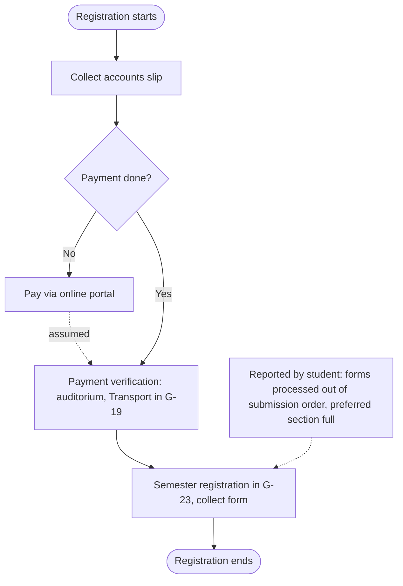
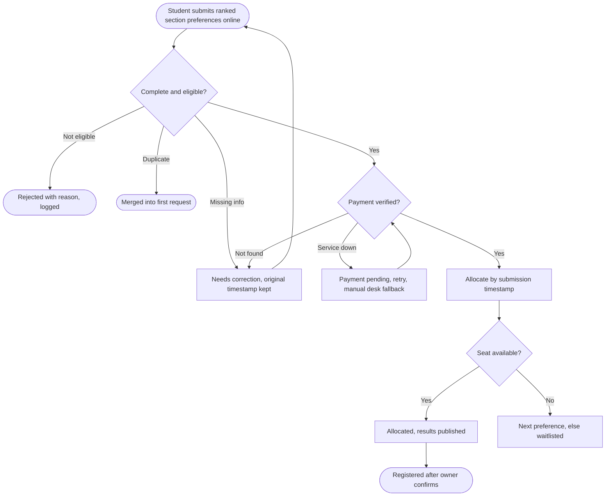

# Process diagrams

## Current process (from the official notice, D2)

The dashed lines are not in the notice. The first is my assumption (A) and the second is my own experience (P5 to P7).

Handoffs: student to accounts, accounts to verification desk, verification desk to registration desk. Approval: the verification and registration desks. Exceptions: none shown in the notice (D6).

## Proposed process

